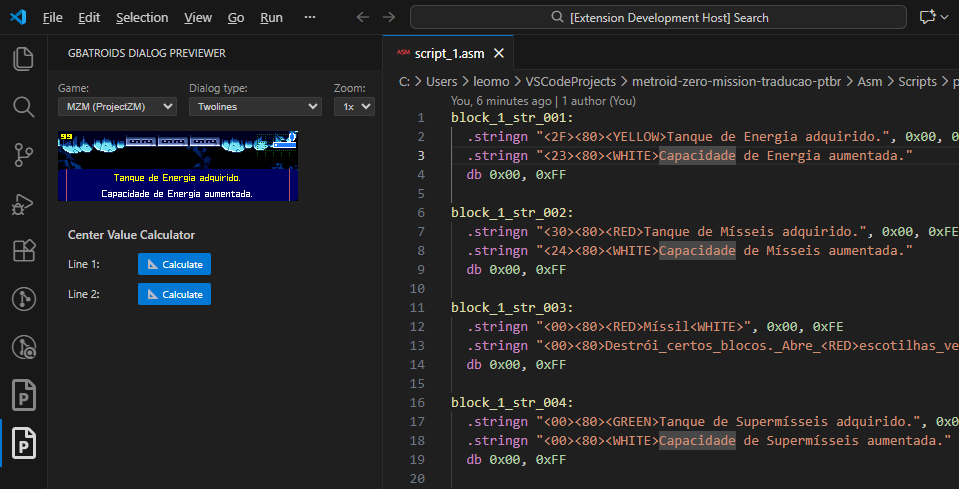
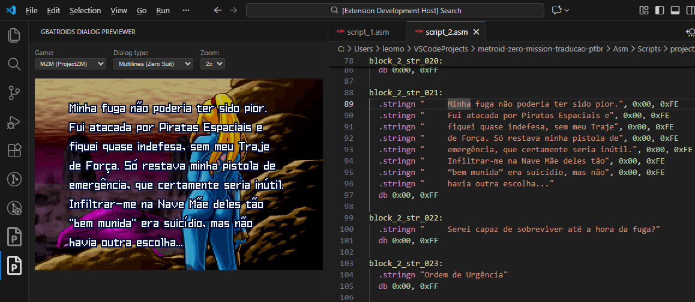

# gbatroids-dialog-previewer

Essa é uma extensão do VSCode que permite pré-visualizar scripts dos jogos de Metroid para Gameboy Advance, especificamente para fins de auxiliar projetos de revisão das traduções existentes de [Metroid Zero Mission](https://github.com/leomontenegro6/metroid-zero-mission-traducao-ptbr) e Metroid Fusion, feitas em 2008.

Ela adiciona uma sidebar à esquerda, que quando ativa, exibe uma área que escuta eventos chamados quando um arquivo é editado no VSCode. Através desses eventos, desde que o usuário esteja editando os arquivos .asm no formato dos repositórios acima, será exibida uma prévia de como o diálogo apareceria ingame.

A ferramenta foi feita pensando nos dois jogos de Metroid de GBA, levando em consideração as possíveis variações de fontes neles (originais ou reduzidas), bem como suas respectivas larguras VWF. Também conta com diferentes modos de pré-visualização, seja de diálogos de duas linhas como falas ou mensagens de obtenção de itens, até cutscenes de múltiplas linhas.

# Como utilizar

Tendo os scripts em ASM de um dos jogos de Metroid de GBA obtidos no repositório em mãos, baixe o arquivo "gbatroids-dialog-previewer-0.0.2.vsix" e [instale-o manualmente no seu VSCode](https://code.visualstudio.com/docs/editor/extension-marketplace#_install-from-a-vsix).

Se feito corretamente, aparecerá um ícone de uma folha de papel com uma letra "P" ao centro, que quando clicado, mostrará as prévias dos diálogos em tempo real. A prévia considera a posição do cursor de texto, tenta determinar o diálogo que o cursor está, e por fim pega seus caracteres para exibir na prévia.

Também é possível alternar entre vários tipos de prévia, bem como zoom de até 3x:

Utilizando dessa prévia, é possível determinar quando um diálogo está próximo do limite da tela ou não, para poder ajustá-lo de acordo, sem precisar testar ingame.

# Como essa extensão foi desenvolvida?

Tomando por base o [mmbn-dialog-previewer](https://github.com/leomontenegro6/mmbn-dialog-previewer) e [cdos-dialog-previewer](https://github.com/leomontenegro6/cdos-dialog-previewer), optei por solicitar ao Copilot em modo Agente para criar a extensão, explicando cada um dos requisitos necessários para extensão, bem como incrementando ela com a inclusão de React no webview, dentre outras coisas. É seguro dizer que pelo menos 80% do código foi redigido dessa forma, comigo repassando os requisitos e passando por vários prompts e iterações até atingir o resultado satisfatório. Foi um bom aprendizado para mim, tanto de IA como React.

Já na parte de compilar ela para arquivos .vsix, eu segui [essas instruções referentes a como publicar extensões](https://code.visualstudio.com/api/working-with-extensions/publishing-extension). Elas ensinam não só como compilar arquivos .vsix, como também como publicá-las no Marketplace do VSCode. No meu caso, por essa ser uma extensão bem específica e útil apenas para um caso de uso em comum, optei por distribuir o .vsix manualmente por aqui mesmo. Ao meu ver, seria mais válido estar no Marketplace se fosse uma solução mais genérica, mas como torná-la genérica daria um trabalhinho considerável, optei por fazer desta maneira.

# Disclaimer

Criei esta ferramenta para auxiliar em diversas iniciativas de fã-traduções de jogos de Metroid de GBA para português brasileiro. Estou disponibilizando o código para quem se interessar. Sintam-se livres para utilizar do seu código à vontade, seja para adaptar para outros jogos ou para torná-la algo ainda maior do que atualmente é.